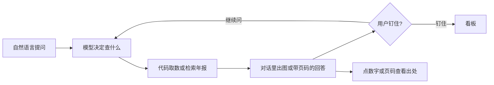
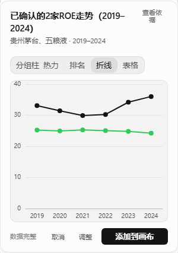
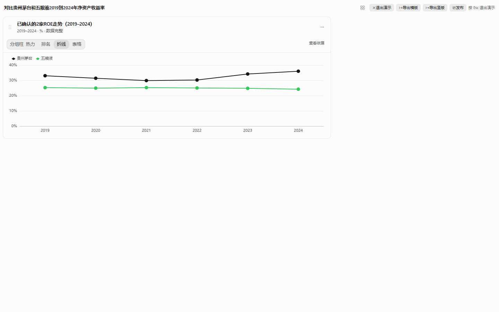
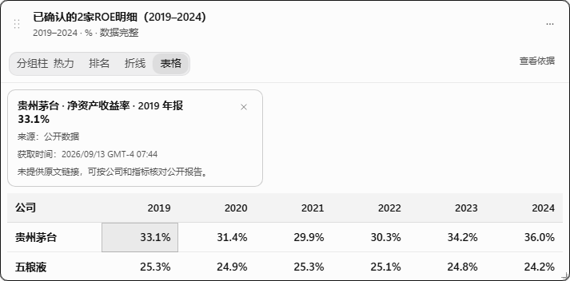

<p align="center">
  
</p>

<h1 align="center">FinFrame</h1>

<p align="center">
  <strong>对话式投研 Agent：图上的每个数字、年报里的每句话，都能点开看出处</strong><br/>
  结构化财报由代码取数出图 · 上传的年报按页检索 · 自托管
</p>

<p align="center">
  <a href="#两条路径">两条路径</a> ·
  <a href="#三个核心差异">核心差异</a> ·
  <a href="#产品工作流">产品工作流</a> ·
  <a href="#评测">评测</a> ·
  <a href="#快速开始">快速开始</a> ·
  <a href="docs/SELF-HOSTING.md">自托管</a>
</p>

> **当前版本：** 可自托管的产品演示。研究图表只做 A 股。上传的年报在本机解析、检索，回答带页码。买卖建议不做。

---

## 先看产品

https://github.com/user-attachments/assets/35fb7c88-4888-4c2c-9f5c-b07a81c675ab

<p align="center">
  <strong>产品演示（03:31）</strong><br/>
  自然语言提问 → 对话里出图 → 点击数字查看来源
</p>

更完整的设计、架构和评测说明见 [面试报告](docs/finframe/interview/explainers.html)。现场演示顺序见 [演示脚本](docs/finframe/demo-script.md)。

## 为什么需要 FinFrame

查一个数，行情软件更快。会出错的是后面几步：两家公司、五年、同一口径要对齐；缺的年份不能画成 0；模型如果在正文里写数字，会按记忆补；年报即使读出来了，没有页码也无法核对。

FinFrame 只做这两件事：

> 把上市公司的标准财务指标放进可核验的图。把上传的年报变成能翻到原文那一页的问答。

它不做选股推荐，不替用户下买卖结论。

## 两条路径

| | 画布：结构化财报 | 资料库：上传的年报 |
|---|---|---|
| 问什么 | `对比宁德时代和比亚迪近五年毛利率` | `招商银行2024年的不良贷款率是多少？请附上页码` |
| 数从哪来 | 代码按公司、指标、报告期向数据源取数 | 检索到的原文段落，引用必须照抄页码 |
| 用户看到 | 对话里的折线或表格，缺的年份是「—」 | 《文档名》p.31，点开翻到那一页 |
| 不做什么 | 研究图表只做 A 股。问美股、港股会直接说明不支持 | 年报里的数字只作摘录，不拿去画图 |

两条路不混用。模型决定查谁、查哪项、要不要翻年报；数值和走势标签由代码给出。

## 三个核心差异

| 真实数据 | 用户控制 | 出处能点开 |
|---|---|---|
| 财务数字由代码查询和计算，模型看不到数值 | 图先出现在对话里，只有用户点「钉住」才进看板 | 图上的点能看到公司、指标、报告期和来源；年报回答能翻到具体页 |

1. **模型做选择，代码做计算。** 早期让模型在正文写数字，对照组一次写出 7 个数据里没有的数。改成正文不写数字、走势只按代码标签说之后，两次运行都是 0。
2. **先预览，再钉住。** AI 可以提议图表，不能自己写进看板。
3. **文档数字不进图表。** 年报检索到的句子只作原文摘录，避免把没核对过的数当成结构化数据。

## 产品工作流



| 1. 对话里先看到 | 2. 钉住后放进看板 | 3. 随时核验 |
|---|---|---|
|  |  |  |
| 确认公司、指标、期间和缺数 | 用户确认过的图留在看板 | 看来源，或翻到年报那一页 |

### 多轮调整不改掉原来的数

| 用户指令 | 系统行为 |
|---|---|
| “去掉五粮液” | 派生新数据集，保留原数据 |
| “只看 2022–2024” | 收窄期间，不把缺的年份画成 0 |
| “改成每年并排柱” | 复用同一数据集，只改视图 |
| “再看 ROE” | 新的查询，生成新数据集 |

## 关键产品决策

| 产品问题 | 当前选择 | 主动承担的代价 |
|---|---|---|
| AI 是否直接修改看板 | 先在对话里预览，用户点「钉住」才写入 | 多一次确认 |
| 模型能不能写财务数字 | 看不到数值，只拿到走势标签 | 解读不能自行报数 |
| 年报里的数字能不能画图 | 不能，只作原文摘录 | 图和年报是两条路 |
| 研究图表覆盖哪些市场 | 只做 A 股，其余直接拒绝 | 不反复重试美股、港股 |
| 真实数据失败怎么办 | 失败就说明失败，不用假数填上 | 宁可没有图，也不展示编出来的成功 |
| 「文档里没有」怎么判断 | 相似度门槛只挡明显无关的，由模型读片段后决定 | 检索层仍会返回段落；调高门槛会误伤有答案的题 |

## 架构

五层从上到下是：浏览器界面、服务端、自研 Agent 引擎、取数与检索、SQLite 存储。主程序是 TypeScript。年报的版面分析和识图认字用 Python，需要时才启动。

一次回答是一个循环：代码组装上下文，模型决定直接回答或调用工具，代码执行后再把结果交回去。最多 50 轮，最后一轮关掉工具。工具清单在会话开始时冻结。

年报检索在本机完成：

1. 解析 PDF。读不出中文就换引擎，仍不行再识图认字。招商银行 2024 年报 362 页，原先只有 3 页可读，兜底后为 351 页。
2. 切成约 500 字，重叠约 15%，不跨页，表格尽量整块。
3. 关键词用中文三字切片，向量默认用 bge-small-zh-v1.5，两路按名次合并（RRF）。
4. 只靠向量命中、且相似度过低的段落丢掉。关键词精确命中不受这个限制。

模型文件放在本机，通过 `DOC_LIBRARY_MODELS_DIR` 指向。没有向量模型时退回关键词检索。

## 评测

三套题库分开记分，不合成一个总分。每次只改一处，每组至少跑两次。

| 题库 | 看什么 | 结果 |
|---|---|---|
| 工具调用 | 生产提示词下多步决策能不能走完。组件层另计第一步工具选择 | 22/24。组件层 93/99（93.9%） |
| 投研场景 | 30 题。财务数字用合成值，模型凭记忆写出真实财报数字即判为编造 | 编造数字检查 30/30，连跑两次 |
| 年报检索 | 6 份 2024 年报、144 题。前 10 条里有没有答案所在页 | 关键词问法 0.83 → 0.96；原话问法 0.50 → 0.67 |

场景题全过，说明这组题还偏容易，区分不出下一轮小改动。年报检索里，12 道无答案的原话题，检索层 0 道被判成「没检到」；「没有」目前靠模型读片段后判断。

说明见 [Agent Eval](docs/AGENT-EVAL.md)、[场景题报告](docs/finframe/seed-v2-report.md)、[检索评测](docs/finframe/rag-eval-report-v2.md)。

## 当前能力与边界

| 已完成 | 尚未进入当前范围 |
|---|---|
| A 股财务比较、时间序列、个股速览 | 研究图表的美股、港股 |
| 多轮调整、钉住进看板、单点溯源 | 投资建议或自动交易 |
| 上传年报，问答带页码，点开翻页 | 重排模型（评测证明有效后再默认打开） |
| 本机混合检索和三套评测 | 把三套分数合成一个总分 |
| 演示脚本和可单独阅读的项目报告 | 公网 SaaS 分享 |

已上传的旧文档不会自动改用新的切块方式，只有新上传的文档受益。

## 快速开始

### 环境要求

- Node.js 24+
- OpenAI 兼容的大模型接口
- 在应用「设置 → 数据源」中配置财务数据源凭证
- 年报向量检索：本机模型目录，见下方

### 本地开发

```bash
cp .env.example .env
npm install
npm run build:packages
```

分别启动服务端和前端：

```bash
# 终端 1
npm run start

# 终端 2
WEB_HTTPS=0 npm run dev
```

打开 `http://127.0.0.1:5173`。新开一个对话，输入：

```text
对比宁德时代和比亚迪近五年毛利率
```

图出现后点「钉住」放进看板，再点折线上的点查看来源。

年报问答：点输入框「+」上传 PDF，等状态变成「已整理」，再问：

```text
这份年报里的不良贷款率是多少？请附上页码
```

向量模型默认 `bge-small-zh-v1.5`。下载并告诉程序放在哪：

```bash
node scripts/download-embedding-models.mjs bge-small-zh-v1.5 --dest <模型目录>
```

启动前设置 `DOC_LIBRARY_MODELS_DIR` 为这个目录的绝对路径。日志里出现 `RAG runtime: embedding=bge-small-zh-v1.5` 即已生效。

### Docker 自托管

```bash
cp compose.env.example compose.env
docker compose up -d --build
```

默认入口：`https://<主机>:8712`。公网开放前需完成账户认领并配置演示用户，详见 [自托管文档](docs/SELF-HOSTING.md)。

## 项目文档

| 文档 | 内容 |
|---|---|
| [面试报告](docs/finframe/interview/explainers.html) | 问题、方案、架构、评测，可单独阅读 |
| [HANDOFF](docs/finframe/HANDOFF.md) | 当前阶段、怎么跑、已知问题 |
| [演示脚本](docs/finframe/demo-script.md) | 2026-10-11 实测过的演示顺序 |
| [ARCHITECTURE](docs/ARCHITECTURE.md) | 系统分层与代码落点 |
| [AGENT-EVAL](docs/AGENT-EVAL.md) | Agent 评测分层和结果解释 |
| [DATA-LAYER](docs/DATA-LAYER.md) | 数据驱动、缓存与数据源 |
| [SELF-HOSTING](docs/SELF-HOSTING.md) | Docker、云服务器和安全配置 |
| [CONTRIBUTING](CONTRIBUTING.md) | 开发与贡献方式 |

## License

[Apache License 2.0](LICENSE)
